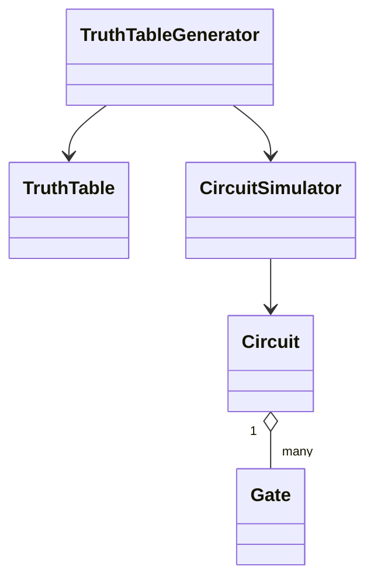
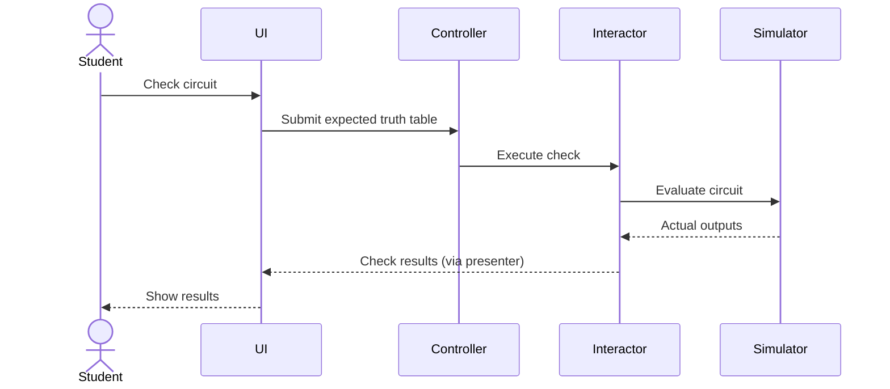

# LogiCoach

## Team Information

### Team Members
- Aryan Pournajafian
- Arian Mahlooji
- Thi Vinh Duy (Alice) Nguyen
- Hai Yen (Ivy) Mai

---

## Project Description

### Domain

LogiCoach is a Java desktop application for students learning digital logic. Students can import Logisim-evolution circuits, compare their behavior with an expected truth table, get guidance from an AI tutor, and generate practice circuits from plain-English descriptions.

---

## User Stories

### User Story 1
As a student, I want to open a Logisim `.circ` file and check it against my expected truth table, so I can identify incorrect rows.

### User Story 2
As a student, I want to save my AI API key and test the connection, so I can use AI features without repeating setup.

### User Story 3
As a student, I want an AI tutor to guide me through mistakes in my circuit without revealing the solution, so I can learn to fix them myself.

### User Story 4
As a student, I want to describe a circuit in plain English and receive a working Logisim circuit, so I can study its design.

---

## Use Cases

### Use Case 1
**Import and Check Circuit:** Load a `.circ` file, simulate its outputs, and compare them with the expected truth table.

### Use Case 2
**Configure AI:** Save an API key and test whether the selected AI provider is available.

### Use Case 3
**AI Tutor:** Ask questions about a circuit and receive guided hints.

### Use Case 4
**Build Circuit:** Describe a circuit in natural language, generate and validate its design, and export a `.circ` file.

---

## Minimal Viable Product (MVP)

| Member | GitHub | Responsibility |
|--------|--------|----------------|
| 1 `Aryan Pournajafian` | `@Aridanted` | Open and check circuits (parser, simulator, checker) |
| 2 `Thi Vinh Duy (Alice) Nguyen` | `@aliceenguyen` | AI connection, circuit JSON format, Swing UI, AI settings |
| 3 `Hai Yen (Ivy) Mai` | `@hyen0804` | AI tutor chat |
| 4 `Arian Mahlooji` | `@A-rian` | AI circuit builder |

---

## Entities

### Entity 1: Circuit
Represents a logic circuit containing components, connections, and wires.

### Entity 2: Gate
Represents a logic gate, its inputs, and its output.

### Entity 3: TruthTable
Represents input combinations and their expected or simulated outputs.

### Entity 4: CircuitDesign
Represents a proposed circuit using input/output labels, gate specifications, and connections.

---

## API Usage

**API Name:** Google Gemini API and Groq API

**Documentation:** [Gemini API](https://ai.google.dev/gemini-api/docs) · [Groq API](https://console.groq.com/docs/overview)

**How it is used in the program:** The AI APIs support tutoring conversations and natural-language circuit generation.

---

## Design Diagrams

### UML Class Diagram



### Sequence Diagrams



---

## How to Run

Requirements: Java 21+ and Maven 3.9+.

```bash
mvn test
mvn exec:java
```

Optional environment variables: `GEMINI_API_KEY`, `GROQ_API_KEY`, `LOGICOACH_DATA_DIR`.
Never commit keys.

---

## Architecture

Clean Architecture with one top-level package per layer. Dependencies point inward only:

```
app  ->  view / data_access  ->  interface_adapter  ->  use_case  ->  entity
```

`src/test/java/architecture/DependencyRuleTest.java` fails the build if a layer imports something it must not. Design choices are logged in [`docs/design-decisions.md`](docs/design-decisions.md).

---

## Workflow

Nobody pushes to `main`. One branch and one pull request per issue (`Closes #N`), one approving review required, CI must be green. See [`.github/pull_request_template.md`](.github/pull_request_template.md).

---

## Notes

AI features require a configured API key. Never commit API keys to the repository. Some features are still under development.
