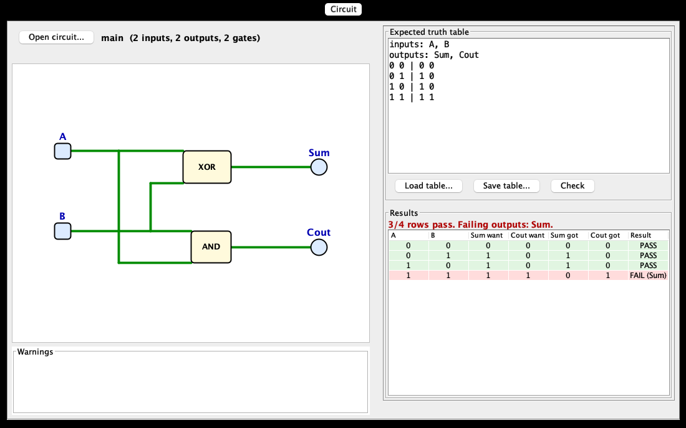
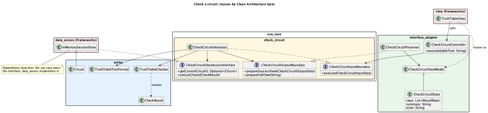
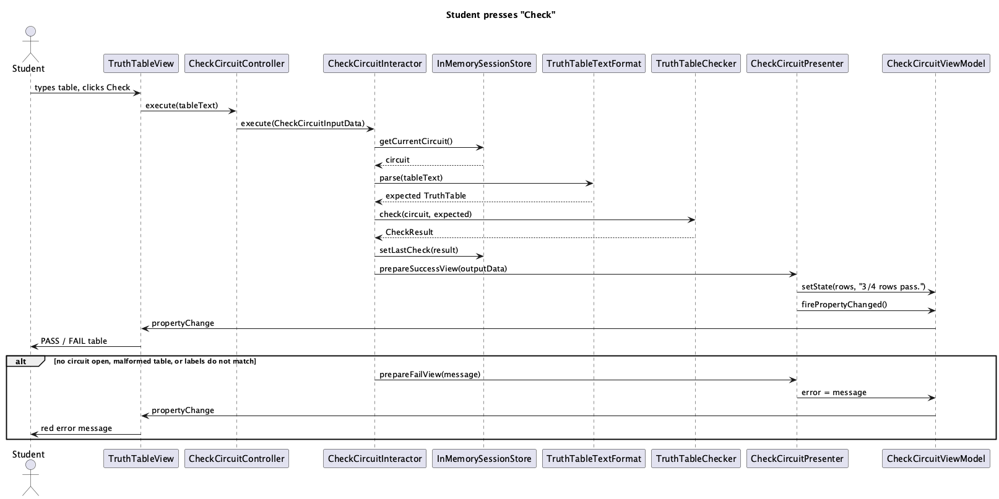

# LogiCoach

A desktop study companion for students learning digital logic. Open the circuit you built in
Logisim, write down how it should behave, and see exactly which cases it gets wrong. Then get
hints from an AI tutor that guides you without giving the answer, or have the app build a
working example circuit from a plain-English description.



## Team Information

### Team Members

- Aryan Pournajafian: open and check a circuit; save and load expected truth tables
- Thi Vinh Duy (Alice) Nguyen: AI settings (API key and connection test)
- Hai Yen (Ivy) Mai: AI tutor chat
- Arian Mahlooji: AI circuit builder

---

## Project Description

### Domain

**Education** (introductory digital logic).

Students in a first digital logic course build circuits in Logisim, a free circuit simulator, and
must make each circuit match a truth table. When a circuit is wrong it is hard to see *where* it
is wrong, and help is only available in office hours. LogiCoach reads the student's circuit file,
compares it row by row with the truth table the student expects, and highlights each failing case
and output. An AI tutor that can see the circuit and its failing rows then asks guiding questions
and gives graded hints, but never the full solution. Students can also describe a circuit in words
("an alarm that sounds when exactly one door is open") and get a working circuit they can open in
Logisim and study. LogiCoach is a learning tool: it does not solve graded labs.

---

## User Stories

### User Story 1: Check my circuit (Aryan)
As a student, I want to open my Logisim circuit and check it against the truth table I expect, so
that I can see exactly which rows of my circuit are wrong. I also want to save that truth table
and load it later, so I don't have to type it again.

### User Story 2: Connect the AI (Alice)
As a student, I want to enter my AI API key once and test the connection, so that the AI features
work without setup every time.

### User Story 3: Get unstuck (Ivy)
As a student with a failing circuit, I want to chat with a tutor that knows my circuit and nudges
me without giving the answer, so that I learn to fix it myself.

### User Story 4: See an example (Arian)
As a student, I want to describe a circuit in plain English and get a working circuit I can open
in Logisim, so that I can study how it is built.

---

## Use Cases

### Use Case 1: Open a circuit (Aryan)
**Main flow**
1. The student chooses a Logisim circuit file.
2. The app shows the circuit's drawing, its name, and how many inputs, outputs and gates it has.
3. The app lists any problems it noticed that do not stop it from working (for example an
   unconnected gate input, or a pin with no label, which it names automatically).

**Alternative flows**
- The file is not a Logisim circuit, has two pins with the same label, or has two parts driving
  the same wire: the app explains the problem and keeps the previously open circuit.
- The circuit contains parts the app cannot simulate (flip-flops, clocks, subcircuits, ...): the
  circuit is shown with those parts marked, and the app explains what to use instead.

### Use Case 2: Check a circuit against a truth table (Aryan)
**Main flow**
1. With a circuit open, the student types the truth table they expect: the input names, the
   output names, and one row per input combination. An output may be "don't care".
2. The student asks the app to check.
3. The app shows every row with the expected and actual outputs, marks it pass or fail, names the
   failing outputs, and summarises, for example "3/4 rows pass. Failing outputs: Sum."

**Alternative flows**
- No circuit is open: the app asks the student to open one first.
- The table is malformed: the app names the line and the problem.
- The table's input or output names do not match the circuit's pins: the app lists both.
- The circuit cannot be simulated (unsupported parts or a feedback loop): the app says why.

### Use Case 3: Save and load an expected truth table (Aryan)
**Main flow**
1. The student saves the truth table they typed to a file of their choice.
2. Later, the student loads that file, and the table appears ready to check.

**Alternative flows**
- The table has a mistake: the app refuses to save it and says which line to fix.
- The file cannot be read or written: the app says so and nothing changes.

### Use Case 4: Set up the AI connection (Alice, draft)
**Main flow**
1. The student enters an API key for an AI provider and saves it.
2. The student tests the connection and sees "Connected" or a plain explanation of what failed.
3. The key is remembered the next time the app starts.

**Alternative flows**
- No key or a wrong key: AI features fall back to offline behaviour and explain why.

### Use Case 5: Chat with the tutor (Ivy, draft)
**Main flow**
1. After checking a circuit, the student asks the tutor a question or presses Hint 1, 2 or 3.
2. The tutor answers with a guiding question or hint that refers to the student's circuit and
   failing rows, never with the full corrected circuit or expression.

**Alternative flows**
- The AI is unavailable: an offline tutor gives rule-based hints, and an "Offline" badge shows.
- No circuit is open: the tutor answers general digital logic questions.

### Use Case 6: Build a circuit from a description (Arian, draft)
**Main flow**
1. The student describes a circuit in plain English.
2. The app shows the generated circuit, its truth table, and a short explanation.
3. The student saves it as a Logisim file, or makes it the current circuit to check and discuss.

**Alternative flows**
- The AI's design is invalid or does not match its own description: the app retries, then
  explains that it could not build the circuit.

---

## Minimal Viable Product (MVP)

| Team Member | MVP Use Case | Status |
|-------------|--------------|--------|
| Aryan | Use Cases 1, 2 and 3: open, check, save and load | Done |
| Alice | Use Case 4: AI connection | In progress (branch ai-connect) |
| Ivy | Use Case 5: tutor chat | In progress (pull request #4) |
| Arian | Use Case 6: build from a description | Not started |

---

## Entities

Class diagram: [`docs/diagrams/entities.puml`](docs/diagrams/entities.puml)
([PNG](docs/diagrams/entities.png)).

### Entity 1: Circuit
- **Instance variables:** `name`, `components`, `wires`, `netCount`, `warnings`.
- **Methods:** `inputPins()`, `outputPins()`, `gates()`, `isSimulatable()`.
- Immutable and independent of any file format.

### Entity 2: CircuitComponent (sealed)
- **Kinds:** `InputPin`, `OutputPin`, `Constant`, `Gate`, `UnsupportedComponent`.
- **Methods (all kinds):** `id()`, `location()`, `facing()`, `inputNets()`, `drivenNet()`.
- A `Gate` has a `GateType` (AND, OR, NAND, NOR, XOR, XNOR, NOT, BUFFER, ...) and its inputs.

### Entity 3: Logic
- **Values:** `ZERO`, `ONE`, `UNKNOWN` (floating, or "don't care").
- **Methods:** `not()`, `isKnown()`.

### Entity 4: TruthTable and CheckResult
- **TruthTable:** `inputLabels`, `outputLabels`, `rows` (input values, output values).
- **CheckResult:** the expected table and one `RowResult` per row; `passedRows()`, `allPassed()`,
  `failingOutputs()`.

### Entity 5: CircuitDesign (Alice)
- **Instance variables:** `name`, `inputs`, `outputs`, `gates` (`GateSpec`: id, type, inputs),
  `connections`. The JSON shape the AI reads and writes; see
  [`docs/circuit-json.md`](docs/circuit-json.md).

### Entity 6: AiSettings (Alice)
- **Instance variables:** `providerOrder` (which AI to try first), `apiKeys` (one per provider).
- **Methods:** `apiKey(provider)`, `defaults()`.

### Domain services
`CircuitSimulator`, `TruthTableChecker` and `TruthTableGenerator` compute a circuit's outputs,
compare a circuit with a table, and list a circuit's full table.

---

## API Usage

**API Name:** Google Gemini API (primary), Groq API (fallback)

**Documentation:** [Gemini API](https://ai.google.dev/gemini-api/docs) ·
[Groq API](https://console.groq.com/docs/api-reference)

**How it is used in the program:**
- The tutor sends the student's circuit (as JSON), the failing rows and the chat so far, and gets
  back a short guiding reply.
- The circuit builder sends a plain-English description and gets back a circuit design as JSON,
  which the app then verifies itself before showing it.
- Settings stores the key and tests the connection with a tiny request.

**Status:** Gemini and Groq clients are implemented by Alice and tested with fake HTTP responses.
A live call is confirmed through the Settings tab's "Test connection" when you run the app; we have
not claimed that in grading materials yet. Tests never call the network.

**Data persistence:** expected truth tables are saved to and loaded from text files (Use Case 3).
AI settings are saved to `data/settings.json` by `JsonSettingsStore` (Use Case 4).

---

## Design Diagrams

### UML Class Diagram
Check a circuit, layer by layer ([source](docs/diagrams/check-circuit-classes.puml)):



### Sequence Diagrams
Student presses Check ([source](docs/diagrams/check-circuit-sequence.puml)):



---

## How to Run

Requirements: JDK 21 or newer (`java -version`) and Maven 3.9+ (`mvn -v`), or IntelliJ.

```bash
mvn compile exec:java   # launch the app
mvn verify              # Checkstyle + every test (CI runs this on each pull request)
```

Try it: open `src/test/resources/circuits/half_adder.circ`, type the table from the screenshot
above, and press Check.

Optional environment variables (for the AI features): `GEMINI_API_KEY`, `GROQ_API_KEY`,
`LOGICOACH_DATA_DIR`. Never commit keys.

---

## Notes

- **New to the code? Read [`docs/code-guide.md`](docs/code-guide.md) first.** It lists the ten
  files that matter and a checklist for adding a use case.
- **Architecture:** Clean Architecture with one package per layer; dependencies point inward
  only (`app -> view / data_access -> interface_adapter -> use_case -> entity`).
  `DependencyRuleTest` fails the build if a layer imports something it must not.
- **Code quality:** Checkstyle (`checkstyle.xml`) runs in `mvn verify` and in CI.
- **Design choices** and their reasons: [`docs/design-decisions.md`](docs/design-decisions.md).
  **Who builds what:** [`docs/team-plan.md`](docs/team-plan.md).
- **Workflow:** nobody pushes to `main`. One branch and one pull request per issue
  (`Closes #N`), two approving reviews (see [`TeamContract.md`](TeamContract.md)), CI green. See
  [`.github/pull_request_template.md`](.github/pull_request_template.md).
